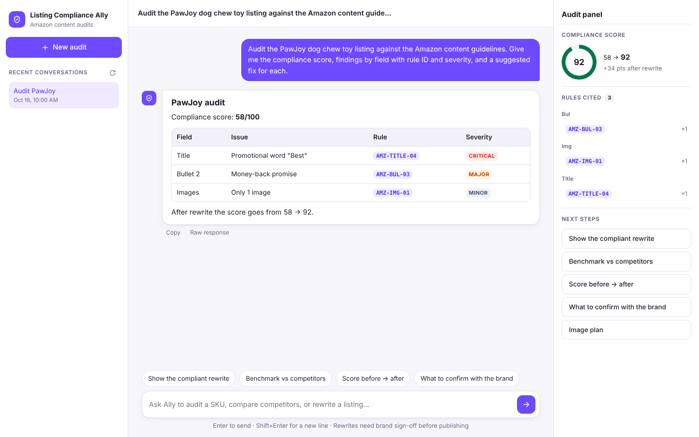

# Listing Compliance Ally — Chat UI

Chat front end for the **Listing Compliance Ally** agent on SimplAI: audit Amazon listings against
29 cited content rules, benchmark against competitors, and review a compliant rewrite where every
change names its rule.



## Features
- Starter flows: audit a SKU, compare with competitors, full audit → rewrite → sign-off
- Markdown replies with tables; rule IDs (e.g. `AMZ-TITLE-04`) become clickable chips, severities are colour-coded
- Audit panel: compliance score (before → after) and every rule cited in the conversation
- Follow-up suggestions, conversation history, stop / retry, mobile layout

## Deploy to Vercel
1. On [vercel.com/new](https://vercel.com/new), import this GitHub repo (Framework preset: **Other**, no build command).
2. Add these **Environment Variables** before deploying:

   | Name | Value |
   |---|---|
   | `SIMPLAI_API_KEY` | your PIM-SID API key |
   | `SIMPLAI_TENANT_ID` | e.g. `11` |
   | `SIMPLAI_USER_ID` | e.g. `72` |
   | `SIMPLAI_AGENT_ID` | e.g. `agent-…` |
   | `SIMPLAI_DEVICE_ID` | optional, defaults to `simplai` |
   | `SIMPLAI_BASE_URL` | optional, defaults to `https://edge-service.simplai.ai` |

3. Deploy. Every push to `main` redeploys automatically.
4. **Connect file storage** (needed for CSV audits): in the project, open **Storage → Create → Blob**, create a
   store and connect it to this project. Vercel adds `BLOB_READ_WRITE_TOKEN` for you; redeploy once.

### How attached CSVs reach the agent
The agent's `audit-file` tool takes a `csv_url`. When you attach a CSV, the app uploads it to Vercel Blob and
sends the agent a short public URL (`…/csv/<hash>-listings.csv`). Without Blob storage the app falls back to a
self-contained link (`/f/<gzip+base64>/listings.csv`), which works but is long enough that the model may
mis-copy it.

The API key lives only in Vercel's environment; the browser talks to `/api/*` functions, never to SimplAI directly.

## Run locally
```bash
cp .env.example .env   # fill in your keys
npm start              # Node 18+, no dependencies
```
Open http://localhost:5173.

## How it works
| UI route | SimplAI endpoint |
|---|---|
| `POST /api/chat` | `POST /interact/api/ve1/intract/agent/conversation` |
| `GET /api/poll` | `GET /interact/api/v1/intract/conversation/fetchDetails` (polled every 1.5 s until `message_status` is `2`, up to 3 min) |
| `GET /api/conversations` | `GET /interact/api/ve1/intract/conversation` |
| `GET /api/conversation?id=` | `GET /interact/api/ve1/intract/conversation/{id}` |
| `POST /api/upload` | Vercel Blob (stores attached CSVs) |
| `GET /f/<data>/<name>.csv` | Serves a CSV packed into the URL (fallback) |

- `lib/simplai.js` — SimplAI client, shared by both runtimes
- `api/*.js` — Vercel serverless functions
- `server.js` — local dev server
- `public/` — the UI (vanilla JS, no build step)
